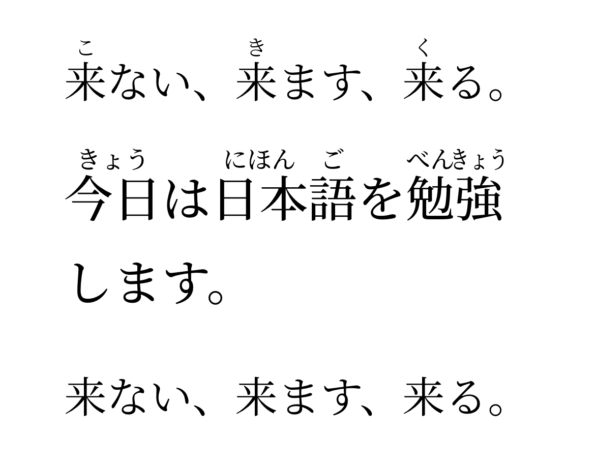

# Furifont Swift

Japanese text with furigana and okurigana-aware readings in Swift apps.
Powered by [Furifont](https://furifont.antfu.me/) and a native Swift port of its
[okurigana helper](https://github.com/antfu/furifont/blob/v0.3.0/packages/helper-web/src/okurigana.ts).
No JavaScript or web view needed.

## Quick start: SwiftUI

Add `https://github.com/arenclissold/furifont-swift` in Xcode's package dependencies
and select the **Furifont** product. Then:

```swift
import Furifont

FurifontText("来ない、来ます、来る。")
```



That's it. The product includes Furifont Serif VF v0.3.0, its matching
reading tables, and automatic font registration. You don't need to download
files, look up font names, or change Info.plist.

```swift
FurifontText("今日は日本語を勉強します。", size: 32, weight: .medium)
    .foregroundStyle(.primary)
    .multilineTextAlignment(.center)

FurifontText("来ない", showsFurigana: false)
```

The view scales with Dynamic Type, handles ruby line spacing, and uses the
original text for accessibility. Hiding furigana keeps the same font and weight.
Use normal SwiftUI modifiers for color, alignment, selection, and line limits;
use `size` and `weight` to configure the font.

Resources are loaded once and reused. Optionally prepare them during startup or
in a background task to avoid first-use work:

```swift
try FurifontText.prepare()
```

Preparation is safe to repeat. If automatic preparation fails, the view falls
back to plain source text; `prepare()` lets you handle that error explicitly.
The bundled preset is Serif with hiragana readings. The same product supports
custom Furifont builds and lower-level text renderers.

## One product, one import

```swift
.package(url: "https://github.com/arenclissold/furifont-swift.git", from: "0.3.0")

// In your target's dependencies:
.product(name: "Furifont", package: "furifont-swift")
```

Use `import Furifont` for the SwiftUI view, font configuration, and reading APIs.
The product includes about 24 MB of font and reading resources before app packaging,
including when you supply your own font. No resources are downloaded at runtime.

Requires Swift 6.0+. Supported Apple platforms: iOS 15+, macOS 12+, tvOS 15+,
watchOS 8+. The Foundation reading APIs also run on Linux; font registration and
SwiftUI rendering are available only on supported Apple platforms.

**Migrating from 0.2:** replace the `FurifontSwiftUI` product dependency and import
with `Furifont`. Existing `FurifontText` calls and `FurifontReadings` APIs still work.
Previously core-only consumers now receive the bundled resources too.

## Customize the bundled font

Create configuration once, then apply it to a view hierarchy:

```swift
var appearance = try FurifontConfiguration.bundled()
appearance.lineHeightMultiple = 1.9
appearance.variations["wght"] = 500

VStack {
    FurifontText("来ない、来ます、来る。")
    FurifontText("今日は日本語を勉強します。")
}
.furifont(appearance)
```

You can set `variations` using four-character OpenType axis tags, and `features`
using four-character OpenType feature tags supported by your font. Invalid tags
are ignored. Explicit variation values override the view's `weight`; `ss01` is
reserved for `showsFurigana`. Standard SwiftUI modifiers still control text color,
alignment, line limits, and selection. `lineHeightMultiple` specifies a minimum:
font ascent and descent are preserved so ruby is not clipped.

## Use your own Furifont build

Bundle the font (`.ttf` or `.otf`), its matching `.ivs.json`, and packed
`okurigana.json` from the same upstream version or custom build. Then:

```swift
let custom = try FurifontConfiguration(fontResource: "MyFurifont")

FurifontText("来ない、来ます、来る。", configuration: custom)

// Or apply to every FurifontText below this view:
ContentView()
    .furifont(custom)
```

This loads `MyFurifont.ttf`, `MyFurifont.ivs.json`, and `okurigana.json` from
`Bundle.main`, registers the font, and discovers its PostScript name. Supply
`bundle:`, `fontExtension: "otf"`, or `okuriganaResource:` for other resources.
In a Swift package, pass your own `Bundle.module`. Construct once and reuse;
file loading is synchronous, so prepare away from the UI thread when appropriate.

For direct file URLs or decoded reading tables:

```swift
let readings = try FurifontReadings(readingsURL: readingsURL, okuriganaURL: okuriganaURL)
let custom = try FurifontConfiguration(fontURL: fontURL, readings: readings)
```

For an already registered font, use `init(fontName:readings:)` with its actual
PostScript name. Custom fonts must be compatible Furifont builds; the package
cannot add furigana glyphs to an ordinary Japanese font.

Configuration priority is the view's explicit `configuration:`, then the nearest
`.furifont(...)` modifier, then bundled Serif. A custom configuration uses its own
reading tables; bundled tables are never substituted. Custom initialization
throws loading and registration errors. The default view falls back to plain text
if the bundled preset fails to load; `FurifontText.prepare()` or
`FurifontConfiguration.bundled()` lets you handle that error explicitly.

## UIKit, AppKit, and custom renderers

Use the same configuration outside SwiftUI:

```swift
let configuration = try FurifontConfiguration.bundled()
let source = "来ない、来ます、来る。"
let display = configuration.readings.annotateOkurigana(source)
let font = configuration.makeFont(size: 28, weight: 400)

// UIKit (import UIKit):
label.font = font as UIFont
label.text = display
label.accessibilityLabel = source

// AppKit (import AppKit):
textField.font = font as NSFont
textField.stringValue = display
textField.setAccessibilityLabel(source)
```

`makeFont` returns a Core Text font with your variations, features, and ruby
visibility settings. Weight uses the OpenType 100–900 scale. UIKit/AppKit callers
manage line layout, Dynamic Type, and accessibility. Keep the original string for
storage and search, and allow enough line height for ruby.

You can also use `FurifontReadings` alone. It does no registration or rendering:

```swift
let readings = try FurifontReadings(fontResource: "MyFurifont")
let display = readings.annotateOkurigana("来ない、来ます、来る。")
```

Its bundle initializer accepts `bundle:` and `okuriganaResource:`. Alternatives
include `init(readingsURL:okuriganaURL:)`, `init(readingsData:okuriganaData:)`, and
`init(lists:pairs:)`. Reading values are immutable and `Sendable`.

## Inspect matches or select a reading explicitly

```swift
for match in readings.matches(in: source) {
    // NSRange in the ORIGINAL string's UTF-16 coordinates, not Character offsets.
    let range = Range(match.range, in: source)!
    print(source[range], match.reading, match.salt)
}

let alternate = readings.annotated("今日", reading: "こんにち") // Optional<String>
let hidden = readings.annotated("今日", reading: "")          // VS225: no ruby
let unknown = readings.annotated("今日", reading: "とくべつ") // nil
```

`selector(for:reading:)` returns a Unicode scalar for explicit readings, including
defaults. `salt(for:reading:)` follows upstream correction semantics: zero means
unavailable or already the default. `matches(in:)` reports corrections in source order.

## Behavior and limits

- Only complete Han runs immediately followed by hiragana are considered.
- The longest matching okurigana prefix wins. An ambiguous longest prefix prevents
  a shorter prefix from selecting a reading.
- Unknown pairs, unsupported readings, and default readings are unchanged.
- Reading order comes from the font's tables. At most 15 readings are supported.
- Existing variation selectors are preserved; processing the output again is safe.
- This is a table-based helper, not a tokenizer or a general Japanese reading engine.
  It cannot infer arbitrary readings or create glyphs missing from the font.
- The SwiftUI view accepts normal Japanese text and font variation selectors.
  It does not parse bracket notation or draw arbitrary custom readings.

For the core API, keep the source string for storage, search, copying, and
accessibility. Transformed strings contain real, invisible Unicode characters.
Render them with the matching Furifont. The SwiftUI view manages its display copy;
text selection can still copy invisible selectors along with the rendered text.

## Development

```sh
swift test --parallel
swift build -c release
```

Tests cover ambiguity, defaults, words, UTF-16 ranges, supplementary Han,
resource loading, custom and bundled font registration, configuration overrides,
variable weights, and ruby hiding.
Core checks run on macOS and Linux; SwiftUI checks run on Apple platforms.

## Credits and licences

Code: MIT. Based on Anthony Fu's `@furifont/helper-web` v0.3.0, with a Swift
adaptation by [arenclissold](https://github.com/arenclissold). This is an independent port.

The bundled resources have separate licences: Furifont Serif is derived from
Adobe Source Han Serif under SIL OFL 1.1; reading data is CC BY-SA 4.0 with EDRDG,
JmdictFurigana, Tatoeba, and other upstream credits. Include those credits in your
application's acknowledgements. Full notices and licences ship in the resource bundle.

See [LICENSE](LICENSE), [THIRD_PARTY_NOTICES.md](THIRD_PARTY_NOTICES.md), and
[bundled resource notices](Sources/Furifont/Resources/NOTICE.md).
